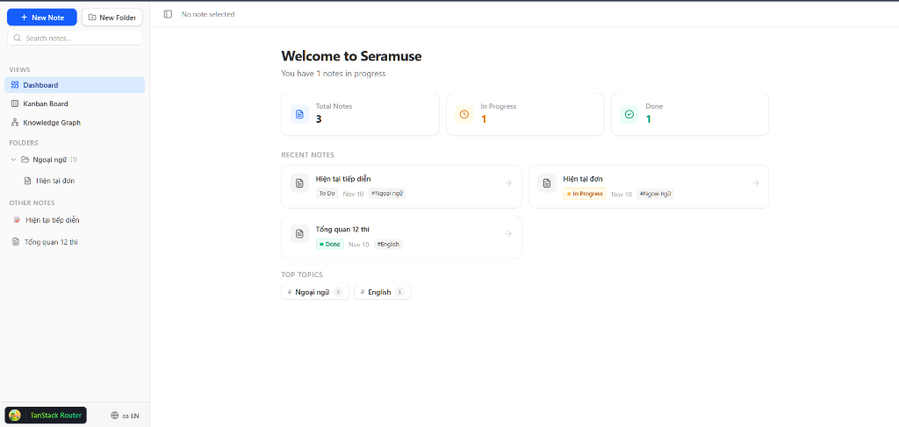
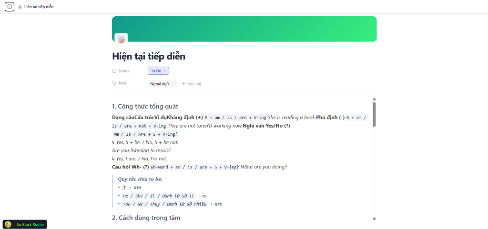
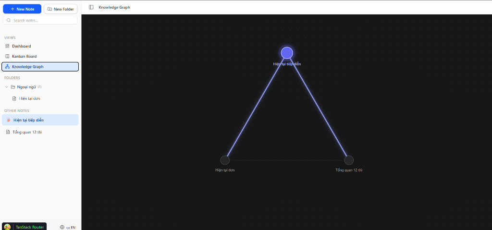
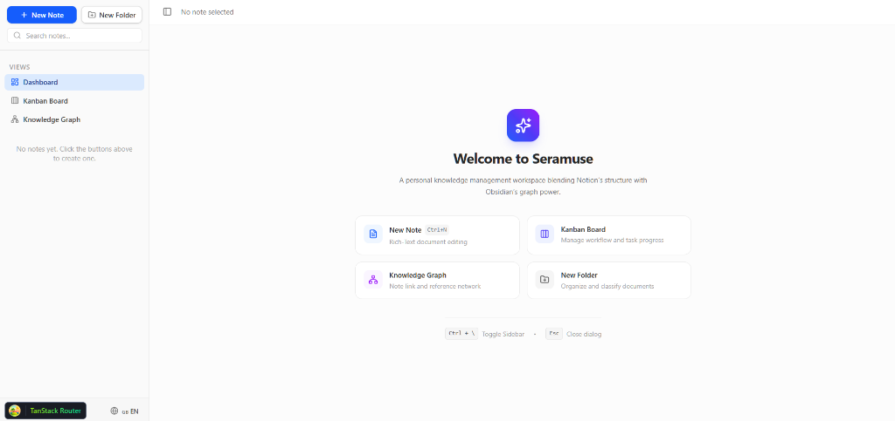

# 🧠 Seramuse Desktop (PKM: Notion + Obsidian)

> **Seramuse Desktop** là ứng dụng Quản lý Tri thức Cá nhân (Personal Knowledge Management - PKM) thế hệ mới trên nền tảng Desktop, kết hợp giữa khả năng **Tổ chức Cơ sở Dữ liệu Trực quan của Notion** và **Mạng Lưới Liên Kết Tri Thức Thần Tốc của Obsidian**.

---

## 📸 Giao Diện & Tính Năng Nổi Bật (Preview & Features)

### 1. Dashboard Tổng Quan & Thống Kê (Overview Dashboard)
> Theo dõi trực quan tiến độ ghi chú (`To Do`, `In Progress`, `Done`), truy cập nhanh các bài viết mới chỉnh sửa và phân loại chủ đề (Top Topics).



### 2. Trình Soạn Thảo Rich-Text Chuẩn Notion (Note Editor & Properties)
> Tích hợp Tiptap v3 headless editor, hỗ trợ ảnh bìa (Cover Image), hệ thống Tag phân loại, trạng thái làm việc và định dạng tài liệu mượt mà.



### 3. Mạng Lưới Đồ Thị Tri Thức (Obsidian-Style Knowledge Graph)
> Trực quan hóa mối liên kết hai chiều giữa các ghi chú dưới dạng mạng lưới tương tác (Interactive Graph), kích thích khả năng liên tưởng và tư duy đa chiều.



### 4. Màn Hình Chào Mừng & Lối Tắt Nhanh (Welcome & Quick Actions)
> Màn hình khởi động tối giản với các phím tắt tiện lợi (`Ctrl + \`, `Esc`) và các hành động nhanh giúp vào guồng làm việc tức thì.



---

## 🚀 Công Nghệ Cốt Lõi (Tech Stack)

- **Platform:** Electron + Vite (TypeScript)
- **UI Framework:** React 19 + Tailwind CSS
- **State Management:** Redux Toolkit (Clean Normalized State $O(1)$)
- **Rich-Text Editor:** Tiptap v3 (Headless ProseMirror StarterKit + Markdown extensions)
- **Icons & Assets:** Lucide React

---

## 🏛️ Quyết Định Thiết Kế Kỹ Thuật Nổi Bật (Key Architectural Decisions)

### 1. Kiến Trúc Kanban: Zero-Latency Brain Dump & Ephemeral State

- **Bối cảnh:** Tại góc nhìn Kanban, người dùng cần ghi nhanh các đầu việc vào bộ nhớ ngắn hạn mà không bị ngắt mạch tư duy (Mental Flow State).
- **Giải pháp:** Xây dựng cơ chế **Adaptive Inline Composer** theo nguyên lý **Progressive Disclosure**:
  - Nhấn `Enter` là tạo task tức thì (<50ms), tự động duy trì `Focus State` để gõ liên tục không cần chạm chuột.
  - Phân tách tuyệt đối giữa **Ephemeral UI State** (quản lý cục bộ tại Component bằng `useState`) và **Redux Global Store** để triệt tiêu tình trạng Re-render thừa và ngăn ngừa ô nhiễm State toàn cục.
  - Tích hợp **Native HTML5 Drag & Drop (Zero-Dependency)** với kiểm tra tương thích `effectAllowed` và `dropEffect`, hoàn toàn không làm phát sinh Layout Shift (CLS = 0).

### 2. Trình Soạn Thảo Rich-Text Tiptap & Hóa Giải Bẫy Con Trỏ

- **Giải pháp:** Áp dụng kỹ thuật unmount/mount có kiểm soát bằng `key={activeNote.id}`:
  - Cô lập hoàn toàn lịch sử Undo/Redo cho từng bài viết.
  - Loại bỏ triệt để bẫy lỗi nhảy con trỏ (Cursor Jumping Bug) khi đồng bộ dữ liệu hai chiều với Redux.
  - Kích hoạt `autofocus: 'end'` giúp người dùng lập tức tiếp tục dòng suy nghĩ mà không cần click chuột.

---

## 🛠️ Cài Đặt & Chạy Dự Án (Getting Started)

### Cài đặt dependencies

```bash
npm install
```

### Chạy môi trường Development

```bash
npm run dev
```

### Kiểm tra kiểu dữ liệu (Typecheck)

```bash
npm run typecheck
```

### Đóng gói ứng dụng Desktop (Build)

```bash
# Windows
npm run build:win

# macOS
npm run build:mac

# Linux
npm run build:linux
```
