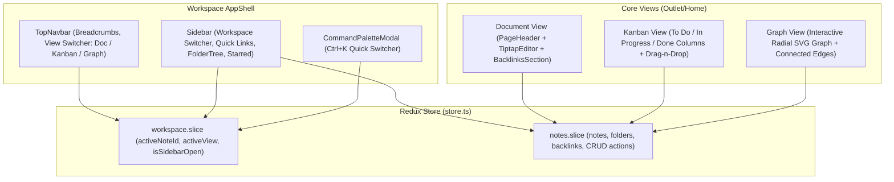

# TÀI LIỆU HIỆN TRẠNG KIẾN TRÚC & TÍNH NĂNG (VIBE CODE AUDIT)
> **Dự án:** Seramuse Desktop (Knowledge Base & Note-taking App)  
> **Thời điểm kiểm tra:** 12/09/2026  
> **Trạng thái:** Toàn bộ tính năng dưới đây được sinh ra trong một lần vibe-code. Tài liệu này lưu trữ đầy đủ thiết kế, luồng dữ liệu, UI/UX và logic của từng module để làm tư liệu tham khảo trước khi dọn dẹp.

---

## 1. TỔNG QUAN KIẾN TRÚC HỆ THỐNG ĐÃ TẠO

Hệ thống được thiết kế theo mô hình **Hybrid Notion & Obsidian**, kết hợp:
1. **Giao diện soạn thảo block & tài liệu dạng văn bản** (Notion style).
2. **Quản lý dữ liệu đa góc nhìn** (Kanban Board theo trạng thái công việc).
3. **Mạng lưới tri thức phi tuyến tính** (Obsidian Knowledge Graph 2D SVG & Wiki-links `[[ ]]`).
4. **Hệ thống điều khiển trung tâm** (Command Palette `Ctrl + K`).



---

## 2. CHI TIẾT TỪNG MODULE TÍNH NĂNG

### 2.1. Module Workspace (`features/workspace`)

Chịu trách nhiệm về khung xương layout (AppShell), điều hướng chính và cây thư mục.

* **[AppShell.tsx](file:///d:/seramuse/Seramuse-Desktop/src/renderer/src/features/workspace/components/AppShell.tsx)**:
  * Khung bao ngoài cùng của toàn bộ ứng dụng, chia thành 2 phần: `Sidebar` (bên trái) và `Main Area` (bên phải).
  * Lắng nghe phím tắt toàn cục:
    * `Ctrl + K` hoặc `Cmd + K`: Bật/tắt `CommandPaletteModal`.
    * `Ctrl + \` hoặc `Cmd + \`: Bật/tắt ẩn/hiện Sidebar.
  * Tích hợp `TopNavbar` cố định ở đỉnh vùng làm việc.

* **[Sidebar.tsx](file:///d:/seramuse/Seramuse-Desktop/src/renderer/src/features/workspace/components/Sidebar.tsx)**:
  * Chiều rộng cố định `w-60` (240px), màu nền đặc trưng Notion `#F7F6F3` (dark mode `#202020`).
  * Khối **Workspace Switcher**: Hiển thị avatar `S` + Tên không gian "Seramuse Space" + Nút thu gọn.
  * Khối **Quick Actions**: Tìm kiếm nhanh (`Ctrl+K`), chế độ xem Kanban (`Columns3`), Graph View (`Network`).
  * Khối **Favorites (Starred)**: Lọc các ghi chú có cờ `isStarred: true`.
  * Khối **Private Pages (FolderTree)**: Cây phân cấp Folder -> Note Pages.
  * Nút chân trang: Thêm trang mới (`+ Trang mới`), thùng rác (`Trash2`).

* **[FolderTree.tsx](file:///d:/seramuse/Seramuse-Desktop/src/renderer/src/features/workspace/components/FolderTree.tsx)**:
  * Render danh sách thư mục lồng trang con.
  * Có nút toggle đóng/mở thư mục (ChevronRight / ChevronDown).
  * Hover vào dòng note hiển thị nút xóa (`Trash2`).
  * Highlight rõ ràng trang đang chọn (`activeNoteId === note.id`).

* **[TopNavbar.tsx](file:///d:/seramuse/Seramuse-Desktop/src/renderer/src/features/workspace/components/TopNavbar.tsx)**:
  * Chiều cao `h-11` (44px), viền đáy mỏng.
  * Breadcrumb: `Icon Thư mục` / `Tên thư mục` / `Icon Note` / `Tiêu đề Note`.
  * Bộ chuyển đổi góc nhìn (View Switcher Tab Group):
    * 📝 **Document** (`activeView === 'document'`)
    * 📋 **Kanban** (`activeView === 'kanban'`)
    * 🕸️ **Graph** (`activeView === 'graph'`)
  * Nút gắn sao nhanh (Star/Unstar).

---

### 2.2. Module Notes & State Management (`features/notes`)

Quản lý toàn bộ cấu trúc dữ liệu tri thức của ứng dụng thông qua Redux Toolkit.

* **Cấu trúc dữ liệu chính ([types.ts](file:///d:/seramuse/Seramuse-Desktop/src/renderer/src/features/notes/types.ts))**:
  ```typescript
  export type ViewMode = 'document' | 'kanban' | 'graph'
  export type NoteStatus = 'To Do' | 'In Progress' | 'Done'

  export interface NoteItem {
    id: string
    title: string
    icon: string
    coverUrl?: string
    folderId: string
    status: NoteStatus
    tags: string[]
    createdAt: string
    content: string // Định dạng HTML lưu từ Tiptap
    isStarred?: boolean
  }

  export interface FolderItem {
    id: string
    name: string
    icon?: string
    isOpen?: boolean
    pageIds: string[]
  }

  export interface BacklinkItem {
    sourceId: string
    sourceTitle: string
    sourceIcon: string
    excerpt: string
  }
  ```

* **Các Reducers & Actions đã có trong [notes.slice.ts](file:///d:/seramuse/Seramuse-Desktop/src/renderer/src/features/notes/notes.slice.ts)**:
  * `updateNoteTitle`: Đổi tiêu đề tức thời.
  * `updateNoteContent`: Cập nhật HTML từ Tiptap vào store.
  * `updateNoteStatus`: Chuyển trạng thái giữa `To Do`, `In Progress`, `Done`.
  * `addTag` / `removeTag`: Quản lý danh sách nhãn (tags).
  * `updateNoteIcon`: Đổi emoji đại diện cho note.
  * `toggleStar`: Đánh dấu yêu thích / bỏ thích.
  * `toggleFolderOpen`: Đóng/mở cây thư mục.
  * `createNote`: Tạo note mới với ID tự sinh `p-${Date.now()}`, tự gán vào folder mặc định.
  * `deleteNote`: Xóa note khỏi state và loại bỏ ID khỏi `pageIds` của folder cha.

---

### 2.3. Module Soạn Thảo Rich-Text (`features/editor`)

* **[TiptapEditor.tsx](file:///d:/seramuse/Seramuse-Desktop/src/renderer/src/features/editor/components/TiptapEditor.tsx)**:
  * Sử dụng `@tiptap/react` kết hợp `@tiptap/starter-kit`.
  * Kích hoạt extensions: `Heading` (H1, H2, H3), `TaskList` & `TaskItem` (checkbox tương tác), `Placeholder`.
  * **Xử lý phím đặc biệt (handleKeyDown)**:
    * Khi bấm phím `/`: Tự động lấy tọa độ con trỏ (`coordsAtPos`) và mở [SlashCommandMenu.tsx](file:///d:/seramuse/Seramuse-Desktop/src/renderer/src/features/editor/components/SlashCommandMenu.tsx).
    * Khi bấm phím `[` liên tiếp 2 lần (`[[`): Mở [WikiLinkPopover.tsx](file:///d:/seramuse/Seramuse-Desktop/src/renderer/src/features/editor/components/WikiLinkPopover.tsx) gợi ý danh sách ghi chú khác để liên kết.
  * **Block Drag Gutter**: Khi hover chuột vào bên trái dòng văn bản, hiển thị nút `+` (thêm block) và nút `GripVertical` (chuẩn bị cho kéo thả block).

* **[PageHeader.tsx](file:///d:/seramuse/Seramuse-Desktop/src/renderer/src/features/editor/components/PageHeader.tsx)**:
  * Phần đầu trang chuẩn Notion:
    * Ảnh bìa (Cover image banner) nếu có.
    * Icon Emoji cỡ lớn (hover để đổi icon: 📝, 💡, 🚀, 📚, 🎯, ⚙️).
    * Input tiêu đề không viền (borderless input), font chữ `text-3xl font-bold`.
    * Metadata Properties Table: Cho phép đổi Status trực tiếp (badge màu) và thêm/xóa thẻ Tags dạng pill.

* **[BacklinksSection.tsx](file:///d:/seramuse/Seramuse-Desktop/src/renderer/src/features/editor/components/BacklinksSection.tsx)**:
  * Khu vực liên kết hai chiều (Bidirectional Links) chuẩn Obsidian nằm ở cuối bài viết.
  * Liệt kê các trang khác đang tham chiếu (link) tới bài viết này kèm trích đoạn (excerpt). Click vào thẻ sẽ lập tức điều hướng sang ghi chú đó.

---

### 2.4. Module Database / Kanban Board (`features/database`)

* **[KanbanView.tsx](file:///d:/seramuse/Seramuse-Desktop/src/renderer/src/features/database/components/KanbanView.tsx)**:
  * Render 3 cột theo trạng thái chuẩn: **To Do**, **In Progress**, **Done**.
  * Cho phép cuộn ngang mượt mà (`overflow-x-auto`).
* **[KanbanColumn.tsx](file:///d:/seramuse/Seramuse-Desktop/src/renderer/src/features/database/components/KanbanColumn.tsx)**:
  * Header mỗi cột có badge màu tương ứng:
    * To Do: Xám / Trung tính
    * In Progress: Xanh dương / Vàng cam
    * Done: Xanh lá cây
  * Nút `+ Thêm trang` nhanh ở đầu mỗi cột để tạo ngay note mang trạng thái đó.
* **[KanbanCard.tsx](file:///d:/seramuse/Seramuse-Desktop/src/renderer/src/features/database/components/KanbanCard.tsx)**:
  * Thẻ ghi chú hiển thị icon, tiêu đề, danh sách tag màu, ngày tạo. Click vào thẻ sẽ chuyển ngay sang `Document View` để soạn thảo.

---

### 2.5. Module Obsidian Knowledge Graph (`features/graph`)

* **[GraphView.tsx](file:///d:/seramuse/Seramuse-Desktop/src/renderer/src/features/graph/components/GraphView.tsx)**:
  * Không dùng thư viện đồ họa 3D nặng nề (như Three.js hay D3) mà tự viết trực tiếp bằng **SVG thuần**.
  * **Thuật toán bố trí Node**: Tính toán tọa độ tròn (Radial Layout) dựa trên góc lượng giác:
    ```typescript
    const angle = (index / total) * 2 * Math.PI
    x = centerX + radius * Math.cos(angle)
    y = centerY + radius * Math.sin(angle)
    ```
  * **Hiệu ứng tương tác**:
    * Khi hover vào một Node (note), các đường liên kết (Edges) nối tới node đó sẽ sáng lên màu tím đậm (`#6366F1`), các đường khác mờ đi.
    * Node đang hover sẽ phóng to với hiệu ứng bóng đổ (drop-shadow).
    * Click vào Node sẽ chuyển ứng dụng về trang tài liệu của Note đó.

---

### 2.6. Module Command Palette (`features/command-palette`)

* **[CommandPaletteModal.tsx](file:///d:/seramuse/Seramuse-Desktop/src/renderer/src/features/command-palette/components/CommandPaletteModal.tsx)**:
  * Modal nổi mở nhanh qua tổ hợp phím `Ctrl + K`.
  * Có input search tìm kiếm realtime theo tên bài viết.
  * Tích hợp các Quick Actions: "Tạo ghi chú mới", "Mở chế độ Kanban", "Mở Knowledge Graph".
  * Điều hướng bằng bàn phím hoặc chuột, bấm `Esc` để đóng.

---

## 3. THIẾT KẾ GIAO DIỆN & HỆ THỐNG DESIGN (DESIGN SYSTEM)

* **Bảng màu (Notion Warm Palette)**:
  * Nền chính: Trắng sáng `#FFFFFF` / Nền Sidebar `#F7F6F3`.
  * Chữ chính: `#37352F` (Màu đen ấm đặc trưng của Notion, không bị chói như đen `#000000`).
  * Dark mode: Nền đen ấm `#202020` và `#121212`, chữ sáng `#E2E8F0`.
  * Điểm nhấn (Accent): Indigo `#6366F1` và Blue `#2563EB`.
* **Icons**: Sử dụng đồng bộ bộ icon `lucide-react` nét mảnh, hiện đại.
* **Typography**: Tận dụng Tailwind typography (`@tailwindcss/typography`) với class `prose dark:prose-invert` để format văn bản soạn thảo chuẩn mực.

---

## 4. ĐÁNH GIÁ CHUYÊN MÔN: ƯU ĐIỂM & RỦI RO CỦA BẢN VIBE CODE

### Ưu điểm:
1. Ý tưởng sản phẩm rất rõ ràng: Kết hợp mượt mà giữa **Notion** (Block editor, properties, kanban) và **Obsidian** (Wiki-links, backlinks, graph view).
2. Thiết kế giao diện (UI) và bảng màu rất tinh tế, chuẩn phong cách desktop PKM hiện đại.
3. Không bị lỗi type check (`tsc` pass).

### Rủi ro & Vấn đề lớn:
1. **Thiếu cơ chế lưu trữ thật (No Local Storage / File System Sync)**: Mọi dữ liệu hiện đang nằm trên memory của Redux với `mockData.ts`. Khi tắt ứng dụng hoặc refresh trang, toàn bộ ghi chú sẽ mất sạch hoặc quay về trạng thái ban đầu.
2. **Editor chưa có Parser thực sự cho Wiki-link**: Việc gõ `[[` chỉ đơn giản chèn chuỗi ký tự `[[Tên note]]` vào HTML chứ chưa có cú pháp parse AST thật của Tiptap để tạo thẻ link tương tác có thể click nhảy trang.
3. **Thư viện trong `package.json` bị dư thừa**: Cài đồng thời cả `formik` + `yup` và `react-hook-form` + `zod` dù không dùng đến form validation phức tạp.
4. **Quá tải cho người học**: Code được sinh ra hàng loạt khiến bạn không thể hiểu được mối liên kết giữa `useEditor`, `Redux dispatch`, `event handlers` và vòng đời của Electron.
