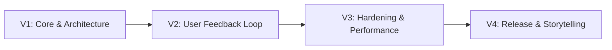

# 🚀 Cẩm Nang Tư Duy Kỹ Sư & Lộ Trình Phát Triển Sản Phẩm (Engineering Mindset & Growth Playbook)

> **Mục tiêu:** Định hình tư duy từ một *coder làm theo tutorial/CRUD* thành một *kỹ sư phần mềm có tư duy sản phẩm*, chủ động giải quyết vấn đề và làm chủ công nghệ trong kỷ nguyên AI.

---

## 🧭 PHẦN 1: 3 CỘT TRỤ CỐT LÕI (CORE PRINCIPLES)

### 1. Có Một Sản Phẩm Tử Tế (Product Mindset > CRUD Tutorial)
* **Thực trạng:** Thị trường tràn ngập CV với các project clone giống hệt nhau (Todo list, Shopee clone đơn giản, CRUD bảng dữ liệu). Những project này chỉ chứng minh bạn biết gõ cú pháp cơ bản.
* **Tư duy sản phẩm tử tế:**
  * Đi trọn vẹn vòng đời phát triển: **Ý tưởng → Phân tích nghiệp vụ → Thiết kế CSDL & Kiến trúc → Code → Kiểm thử (Test) → Người dùng thật dùng thử (Feedback) → Sửa & Tối ưu (Refactor) → Đóng gói/Deploy (Release)**.
  * Đặt câu hỏi: *Sản phẩm giải quyết nỗi đau gì? Ai dùng? Người dùng thao tác luồng nào? Gặp tình huống bất thường (Edge Cases) thì app ứng biến ra sao?*
  * **Giá trị khi phỏng vấn:** Bạn có câu chuyện thật để kể (Storytelling) về:
    * Lỗi kỳ quặc nhất từng gặp và cách debug.
    * Lý do đưa ra các quyết định kiến trúc (Trade-offs).
    * Phản hồi của người dùng đã thay đổi tư duy thiết kế của bạn như thế nào.

### 2. Chủ Động Giải Quyết Vấn Đề (Ownership & Communication)
* **Thái độ quyết định:** Intern/Fresher chưa biết nhiều là điều bình thường, nhưng thụ động ngồi chờ cầm tay chỉ việc là điểm trừ lớn nhất.
* **Nguyên tắc đặt câu hỏi hiệu quả:**
  * ❌ *Thụ động:* "Anh ơi chỗ này bị lỗi, sửa giúp em với."
  * ✅ *Chủ động:* "Em gặp lỗi A khi thực hiện hành vi B. Em đã tra cứu tài liệu và thử giải pháp 1, giải pháp 2 nhưng vẫn vướng ở C. Em phán đoán nguyên nhân có thể do D. Anh/chị xem giúp em hướng đi này có đúng không?"
* **Quy trình 15 phút tự thân:** Gặp bug → Đọc kỹ stack trace → Tự search/nghiên cứu trong 15-30 phút → Lập giả thuyết → Thử nghiệm → Nếu vẫn tắc thì tổng hợp lại và đi hỏi.

### 3. Dùng AI Làm Đòn Bẩy, Giữ Não Của Kỹ Sư (AI-Augmented, Not AI-Dependent)
* **Nguyên tắc:** Tận dụng AI tối đa để tăng tốc độ gõ phím, sinh boilerplate và gợi ý giải pháp, nhưng **tuyệt đối không để AI suy nghĩ thay mình**.
* **Checklist thẩm định code từ AI:**
  1. Mình có hiểu từng dòng code AI vừa viết không?
  2. Tại sao lại dùng giải pháp này mà không phải giải pháp khác?
  3. Có rủi ro tiềm ẩn nào không (Memory leak, Unhandled rejection, Re-render vô tận, XSS/Injection)?
  4. Nếu ngày mai đoạn này phát sinh bug khi chạy thực tế, mình có tự debug được không?
* **Cách biến AI thành Mentor:**
  * Nhờ AI: *"Hãy review đoạn code sau theo góc nhìn của Senior Dev về mặt hiệu năng và Clean Code."*
  * Nhờ AI: *"Tìm giúp tôi 5 edge cases mà đoạn logic này chưa xử lý."*
  * Nhờ AI: *"Giải thích cơ chế hoạt động bên dưới của hàm/hook này."*

---

## 🛠️ PHẦN 2: LỘ TRÌNH ỨNG DỤNG TRỰC TIẾP VÀO DỰ ÁN SERAMUSE DESKTOP

Dự án **Seramuse Desktop** (Notion + Obsidian Hybrid trên Electron/React/TS) sở hữu tiềm năng rất lớn để trở thành **"Sản phẩm tử tế điểm 10 trong CV"**. Dưới đây là lộ trình hiện thực hóa:

### Giai đoạn 1: Hoàn thiện bài toán kỹ thuật cốt lõi (Technical Depth)
- [x] **Kiến trúc Kanban & Zero-latency input:** Đã phân tách rõ Ephemeral UI State và Global Redux State (ghi điểm lớn về Performance).
- [x] **Tiptap Editor Isolation:** Kỹ thuật unmount/mount `key={activeNote.id}` xử lý lỗi nhảy con trỏ và cô lập Undo/Redo stack.
- [ ] **Lưu trữ dữ liệu bền vững (Persistence & Local Database):**
  - Tích hợp SQLite (thông qua Better-SQLite3) hoặc IndexedDB/RxDB thay vì chỉ lưu tạm trên RAM/LocalStorage.
  - Tách bạch rõ luồng IPC giữa Main Process và Renderer Process theo chuẩn bảo mật (`contextIsolation: true`, `sandbox: true`).

### Giai đoạn 2: Vòng lặp người dùng thật (User Testing & Feedback Loop)
1. **Đóng gói bản cài đặt thử nghiệm:** Chạy `npm run build:win` để tạo file `.exe` cài đặt hoặc bản Portable.
2. **Giao cho 3 - 5 người dùng thử (bạn bè, đồng nghiệp, cộng đồng sinh viên IT):**
   * Cho họ dùng để ghi chép bài học hoặc quản lý công việc trong 3-5 ngày.
   * *Không can thiệp, không hướng dẫn trước* để xem họ có bị lạc trong giao diện không.
3. **Thu thập phản hồi:**
   * Những thao tác nào khiến họ bối rối?
   * Font chữ, độ tương phản, phím tắt có tiện dụng không?
   * Có tình huống nào gây crash app hoặc mất dữ liệu không?
4. **Viết nhật ký Release (Changelog):** Ghi chép lại các lỗi người dùng tìm ra và cách bạn refactor code để sửa chúng.

### Giai đoạn 3: Rèn luyện kỹ năng phỏng vấn (Storytelling Framework)

Khi phỏng vấn, áp dụng mô hình **STAR (Situation - Task - Action - Result)** để chia sẻ về Seramuse Desktop:

| Yếu tố | Cách trả lời mẫu với Seramuse Desktop |
| :--- | :--- |
| **S (Situation)** | *"Em muốn xây dựng một ứng dụng ghi chép tri thức kết hợp giữa Notion và Obsidian, hoạt động mượt mà không có độ trễ trên Desktop."* |
| **T (Task)** | *"Thách thức lớn nhất là xử lý trình soạn thảo Rich-Text và bảng Kanban có thể kéo thả với hàng trăm thẻ mà không bị drop FPS và không bị nhảy con trỏ khi sync state."* |
| **A (Action)** | *"Em phân tách rõ Ephemeral UI State với Redux Global Store để triệt tiêu Re-render. Với Tiptap, em cô lập trạng thái bằng cơ chế unmount/mount qua key định danh, kiểm soát chặt chẽ luồng IPC của Electron."* |
| **R (Result)** | *"App đạt tốc độ phản hồi tạo task dưới 50ms, bộ nhớ RAM được tối ưu, đóng gói thành công file `.exe` cho người dùng thực tế và nhận được feedback tích cực về trải nghiệm mượt mà."* |

---

## 📋 PHẦN 3: TIÊU CHUẨN TÁC PHONG CHUYÊN NGHIỆP (ENGINEERING DISCIPLINE)

1. **Kỷ luật Git (Git Hygiene):**
   * Viết commit message theo chuẩn [Conventional Commits](https://www.conventionalcommits.org/) (ví dụ: `feat: add kanban drag-and-drop`, `fix(editor): prevent cursor jump on sync`).
   * Sử dụng branch rõ ràng (`feature/kanban-view`, `fix/ipc-leak`).
2. **Tài liệu hóa (Clean Documentation):**
   * Giữ file `README.md` chuyên nghiệp với ảnh chụp màn hình/GIF demo, bảng so sánh tính năng và hướng dẫn cài đặt rõ ràng.
   * Duy trì thư mục `docs/` để ghi nhận các quyết định kiến trúc (ADR - Architecture Decision Records).
3. **Nền tảng vững chắc (CS Fundamentals):**
   * Nắm vững cơ chế Event Loop của Node.js & Browser.
   * Hiểu về độ phức tạp thuật toán $O(1)$ vs $O(N)$ khi chuẩn hóa dữ liệu Redux (Normalized State).
   * Hiểu về IPC, bảo mật Electron, kiến trúc Process Model (Main vs Renderer).

---

## 📦 PHẦN 4: BACKLOG & Ý TƯỞNG NÂNG CẤP CHO VERSION SAU (V2.0+)

> **Chiến lược sản phẩm:** *"Make it work → Make it right → Make it fast"* (Kent Beck).
> - **Hiện tại (V1.0):** Ưu tiên hoàn thiện trọn vẹn bộ tính năng nghiệp vụ cốt lõi (Core Feature Completeness) để sản phẩm chạy thông suốt toàn diện.
> - **Tương lai (V2.0+):** Triển khai các tối ưu chuyên sâu về hiệu năng, thuật toán và trải nghiệm nâng cao (Advanced UX/UI & Performance).

### 1. Kanban Cấp Độ 2 (Exact Reordering & Insertion)
* **Ý tưởng:** Hỗ trợ sắp xếp thứ tự ưu tiên các thẻ ghi chú ngay trong cùng một cột, hoặc chèn vào vị trí chính xác giữa 2 thẻ bất kỳ.
* **Giải pháp kỹ thuật đã định hình:**
  * **Xác định vị trí chèn:** Sử dụng `e.clientY` so sánh với `rect.top + rect.height / 2` trong `onDragOver` của thẻ mục tiêu để phân biệt nửa trên (chèn trước) và nửa dưới (chèn sau).
  * **Chỉ báo trực quan (Drop Indicator):** Hiển thị vạch màu xanh phát sáng mượt mà tại vị trí thẻ sẽ rơi vào, tránh nhấp nháy giao diện.
  * **Thuật toán Fractional Indexing ($O(1)$ thay vì $O(N)$):**
    * Gán trường `order: number` cho mỗi note (ví dụ: 1000, 2000, 3000).
    * Khi chèn thẻ vào giữa: `newOrder = (orderPrev + orderNext) / 2`.
    * Chỉ cần cập nhật duy nhất 1 note trong Redux/DB, không phải tính lại index của hàng trăm note khác.

### 2. Tối Ưu Quy Mô Lớn (Virtualization for Scale)
* Áp dụng Virtualized List (`react-window` hoặc `@tanstack/react-virtual`) khi cột Kanban hoặc danh sách ghi chú vượt quá 500 - 1.000 items, chỉ render những thẻ đang nhìn thấy trong viewport để giữ FPS luôn ở mức 60.

### 3. Tương Tác Kéo Thả Nâng Cao
* Bổ sung hiệu ứng chuyển động mượt mà (smooth layout animation) khi các thẻ dạt ra nhường chỗ cho thẻ mới chèn vào.

