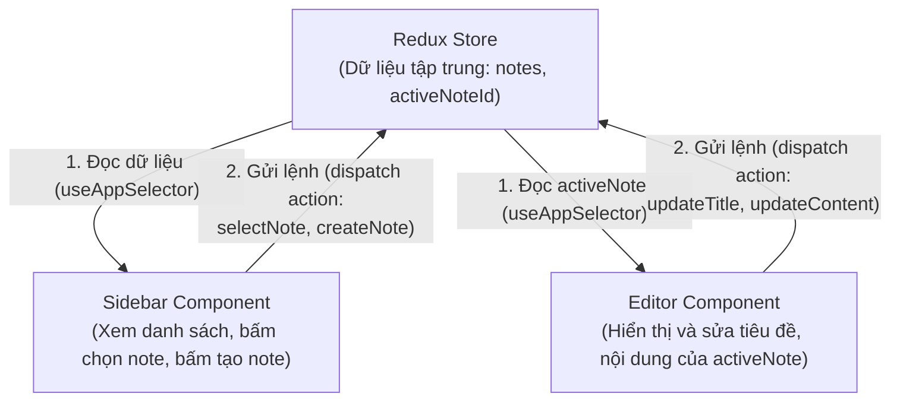

# HƯỚNG DẪN TỰ TAY PHÁT TRIỂN SERAMUSE DESKTOP (STEP-BY-STEP ROADMAP)

> **Mục tiêu:** Giúp bạn làm chủ 100% codebase, tự tay xây dựng một ứng dụng ghi chú cá nhân (PKM - Personal Knowledge Management) chuyên nghiệp trên nền tảng Electron + React + TypeScript + Redux Toolkit.
> **Phương châm:** _Không vibe coding. Code từng dòng, hiểu từng hàm, kiểm thử từng tính năng._

---

## MÔ HÌNH KIẾN TRÚC TỔNG THỂ (THE BIG PICTURE)

Trước khi viết bất kỳ dòng code nào, bạn cần nắm rõ luồng dữ liệu 1 chiều (Unidirectional Data Flow) của ứng dụng:



---

## LỘ TRÌNH 6 GIAI ĐOẠN (6-PHASE ROADMAP)

```
Phase 1: Quản lý Dữ liệu Cốt lõi (Types & Redux Store)
   │
   ▼
Phase 2: Bố cục 2 Cột (Sidebar Danh sách + Vùng Soạn thảo Đơn giản)
   │
   ▼
Phase 3: Đồng bộ Soạn thảo Real-time (Title Input + Textarea)
   │
   ▼
Phase 4: Tích hợp Rich-text Editor (Tiptap v3 StarterKit)
   │
   ▼
Phase 5: Cấu trúc Thư mục & Tổ chức Tri thức (Folder Tree & Tags)
   │
   ▼
Phase 6: Tính năng Nâng cao (Obsidian Graph View & Notion Kanban)
```

---

## GIAI ĐOẠN 1: QUẢN LÝ DỮ LIỆU CỐT LÕI (CORE DATA & STORE)

Mọi ứng dụng ghi chú đều bắt đầu từ **Mô hình Dữ liệu (Data Model)**. Bạn cần trả lời: Một ghi chú gồm những thông tin gì?

### 1.1. Định nghĩa Type Interfaces (`src/renderer/src/features/notes/types.ts`)

- **Mục tiêu:** Tạo hợp đồng kiểu dữ liệu rõ ràng, ngăn chặn lỗi typo.
- **Cấu trúc tối giản cần tạo:**
  ```typescript
  export interface Note {
    id: string
    title: string
    content: string
    createdAt: string
    updatedAt: string
  }

  export interface NotesState {
    notes: Record<string, Note> // Lưu dạng Key-Value (Dictionary) để tìm kiếm O(1)
    activeNoteId: string | null // ID của note đang được mở
  }
  ```
  > **Tại sao dùng `Record<string, Note>` thay vì mảng `Note[]`?**
  > Khi ứng dụng có hàng nghìn ghi chú, việc tìm một note theo ID trong mảng tốn $O(N)$. Dùng object key-value `state.notes[id]` tốn $O(1)$ tức thời.

### 1.2. Viết Redux Slice (`src/renderer/src/features/notes/notesSlice.ts`)

- **Mục tiêu:** Định nghĩa các hành vi thay đổi dữ liệu (Reducers).
- **Các action tối thiểu cần có:**
  1. `createNote`: Thêm một ghi chú rỗng với ID ngẫu nhiên (`Date.now().toString()`), đặt tiêu đề mặc định là "Ghi chú mới", và tự động gán `activeNoteId` trỏ vào note vừa tạo.
  2. `selectNote`: Nhận vào `id: string` và cập nhật `activeNoteId`.
  3. `updateNoteTitle`: Nhận vào `{ id: string; title: string }`.
  4. `updateNoteContent`: Nhận vào `{ id: string; content: string }`.
  5. `deleteNote`: Nhận vào `id: string`, xóa note đó khỏi state và reset `activeNoteId` nếu note đang bị xóa chính là note đang mở.

### 1.3. Đăng ký vào Root Store (`src/renderer/src/app/store.ts`)

- Gắn `notesReducer` vào object reducers của `configureStore`.

**Tiêu chí nghiệm thu Giai đoạn 1:**

- Chạy `npm run typecheck` không có lỗi.
- Mở Redux DevTools (F12) thấy state khởi tạo thành công với `notes` và `activeNoteId`.

---

## GIAI ĐOẠN 2: BỐ CỤC 2 CỘT (SPLIT-PANE LAYOUT)

Xây dựng bộ khung giao diện để người dùng nhìn thấy danh sách và không gian làm việc.

```
┌─────────────────┬────────────────────────────────────────────────────────┐
│  SIDEBAR        │  MAIN CONTENT AREA                                     │
│                 │                                                        │
│  [+ Ghi chú mới]│  Tiêu đề ghi chú...                                    │
│                 │  ────────────────────────────────────────────────────  │
│  • Ghi chú 1    │  Nội dung văn bản ghi chú...                           │
│  • Ghi chú 2    │                                                        │
│  • Ghi chú 3    │                                                        │
│                 │                                                        │
└─────────────────┴────────────────────────────────────────────────────────┘
```

### 2.1. Component `Sidebar` (`features/notes/components/Sidebar.tsx`)

- Sử dụng `useAppSelector` để lấy danh sách `Object.values(notes)` và `activeNoteId`.
- Sử dụng `useAppDispatch` để gửi action:
  - Nút bấm `+ Ghi chú mới`: gọi `dispatch(createNote())`.
  - Click vào từng dòng note trong danh sách: gọi `dispatch(selectNote(note.id))`.
  - Highlight dòng note đang được chọn bằng màu nền khác biệt (ví dụ `bg-neutral-200` hoặc `bg-blue-50`).

### 2.2. Ghép vào Layout Trang Chủ (`features/home/Home.tsx`)

- Dùng Flexbox: `<div className="flex h-screen w-screen overflow-hidden">`.
- Cột trái: `<Sidebar />` với chiều rộng cố định (ví dụ `w-64` ~ 256px).
- Cột phải: Vùng hiển thị chính với `flex-1 flex flex-col`.

**Tiêu chí nghiệm thu Giai đoạn 2:**

- Bấm nút "+ Ghi chú mới" -> danh sách ở Sidebar xuất hiện thêm 1 dòng.
- Bấm vào các dòng khác nhau -> trạng thái highlight chuyển đổi chính xác.

---

## GIAI ĐOẠN 3: ĐỒNG BỘ SOẠN THẢO (TITLE & CONTENT SYNC)

Trước khi dùng các thư viện soạn thảo phức tạp như Tiptap, hãy làm chủ việc đồng bộ dữ liệu bằng **thẻ HTML chuẩn (`<input>` và `<textarea>`)**. Điều này giúp bạn hiểu rõ cơ chế State Management mà không bị phân tâm bởi plugin bên thứ ba.

### 3.1. Component `NoteEditor` (`features/notes/components/NoteEditor.tsx`)

- Lấy `activeNote` từ Redux Store: `state.notes[state.activeNoteId]`.
- Nếu `!activeNote`: Hiển thị màn hình trống _"Chọn hoặc tạo một ghi chú để bắt đầu"_.
- Nếu có `activeNote`:
  - `<input>` cho tiêu đề: `value={activeNote.title}`, `onChange={(e) => dispatch(updateNoteTitle({ id: activeNote.id, title: e.target.value }))}`.
  - `<textarea>` cho nội dung: `value={activeNote.content}`, `onChange={(e) => dispatch(updateNoteContent({ id: activeNote.id, content: e.target.value }))}`.

> **Bài học quan trọng về Controlled Components & In-Memory Sync:**
> Bạn sẽ quan sát thấy rằng khi gõ vào `<input>`, tiêu đề ở Sidebar cũng lập tức thay đổi theo thời gian thực! Đó là sức mạnh của Single Source of Truth trong Redux khi dữ liệu đang được lưu trữ trực tiếp trên RAM.

> [!TIP]
> **Kinh nghiệm & Hướng dẫn kỹ thuật: Debounce khi tích hợp Lưu trữ (Persistence / SQLite / IPC)**
>
> - **Vấn đề:** Hiện tại việc cập nhật diễn ra tức thời vì chỉ lưu trên RAM (Redux Store). Sau này khi chuyển sang lưu trữ bền vững (ghi file Markdown/JSON vào ổ cứng hoặc gửi qua Electron IPC tới Main process / SQLite Database), nếu mỗi phím gõ (`onChange`) đều gọi ghi đĩa sẽ gây nghẽn I/O (Disk thrashing), giảm giật lag và hao pin.
> - **Giải pháp tối ưu:**
>   1. **Giao diện (UI State):** Tiếp tục cập nhật tức thời trên Redux RAM để Sidebar & Editor luôn phản hồi mượt mà không có độ trễ.
>   2. **Tầng lưu trữ (Persistence Layer):** Áp dụng kỹ thuật **Debounce** (thông qua custom hook `useDebounce` hoặc Redux listener middleware) đợi người dùng ngưng gõ khoảng 300ms – 500ms mới kích hoạt lệnh ghi đĩa/gửi IPC.
>   3. **Cơ chế an toàn (Safety Flush):** Tự động ép lưu ngay lập tức (flush) khi người dùng chuyển sang ghi chú khác hoặc khi đóng ứng dụng để không bị mất dữ liệu.
> - **Lộ trình:** AI sẽ chủ động nhắc nhở và hướng dẫn bạn tự tay code chi tiết kỹ thuật này khi bước vào giai đoạn kết nối Lưu trữ/IPC.

**Tiêu chí nghiệm thu Giai đoạn 3:**

- Gõ đổi tên ở ô tiêu đề -> Tiêu đề ở danh sách Sidebar đổi theo ngay lập tức.
- Chuyển qua lại giữa các ghi chú khác nhau -> Nội dung hiển thị tương ứng không bị lẫn lộn.

---

## GIAI ĐOẠN 4: TÍCH HỢP RICH-TEXT VỚI TIPTAP V3

Sau khi luồng Redux đã hoạt động hoàn hảo, thay thế `<textarea>` bằng trình soạn thảo khối chuyên nghiệp **Tiptap**.

### 4.1. Kiến thức cốt lõi về Tiptap

Tiptap là một Headless Editor bọc quanh ProseMirror. Nó không quản lý DOM như React thông thường mà có hệ thống Document Model riêng.

### 4.2. Khởi tạo Editor cơ bản

```typescript
import { useEditor, EditorContent } from '@tiptap/react'
import StarterKit from '@tiptap/starter-kit'

const editor = useEditor({
  extensions: [StarterKit],
  content: activeNote.content,
  onUpdate: ({ editor }) => {
    dispatch(updateNoteContent({ id: activeNote.id, content: editor.getHTML() }))
  }
})
```

### 4.3. Bẫy lỗi kinh điển cần tránh (Pitfall Alert ⚠️)

- **Lỗi con trỏ nhảy về đầu dòng khi gõ:**
  - Nguyên nhân: Do dùng `useEffect` gọi `editor.setContent(content)` mỗi khi Redux state thay đổi.
  - Cách khắc phục: Chỉ gọi `setContent` khi `id` của ghi chú thay đổi (chuyển sang note khác), không gọi lại khi nội dung thay đổi do chính người dùng gõ.
  ```typescript
  useEffect(() => {
    if (editor && activeNote) {
      // Chỉ cập nhật lại editor nếu nội dung khác biệt hoàn toàn (đổi note)
      if (editor.getHTML() !== activeNote.content) {
        editor.commands.setContent(activeNote.content)
      }
    }
  }, [activeNote?.id]) // Chỉ lắng nghe id!
  ```

---

## GIAI ĐOẠN 5: TỔ CHỨC CÂY THƯ MỤC & THUỘC TÍNH TRI THỨC (NOTION PROPERTIES)

Nâng cấp Sidebar từ danh sách phẳng (Flat List) thành cây thư mục (Hierarchical Tree) và trang bị bảng thuộc tính (Properties Table) chuẩn Notion.

### 5.1. Cây Thư mục Phân cấp (`FolderItem.tsx`)

1. Định nghĩa `Folder` trong `types.ts` và gán `folderId?: string` trong `Note`.
2. Bổ sung các reducers: `createFolder`, `toggleFolder`, `updateFolderName`, `deleteFolder`, `moveNoteToFolder`.
3. Render thư mục lồng ghi chú: Lọc các ghi chú có `note.folderId === folder.id` bên trong từng thư mục.

### 5.2. Bảng Thuộc tính Chuẩn Notion (`NoteProperties.tsx`)

1. **Trạng thái công việc (`NoteStatus` Enum):** `TODO = 'To Do'`, `IN_PROGRESS = 'In Progress'`, `DONE = 'Done'`.
2. **Custom Dropdown bo tròn:**
   - Thay thế thẻ `<select>` mặc định của hệ điều hành bằng `<button>` và popup menu `<div>` bo góc `rounded-lg`, đổ bóng `shadow-lg`.
   - Sử dụng `useRef` và `useEffect` bắt sự kiện `mousedown` trên `document` để tự động đóng menu khi click ra ngoài (`!dropdownRef.current?.contains(event.target)`).
   - Tự động gỡ bỏ sự kiện (`removeEventListener`) trong hàm cleanup khi menu đóng để tối ưu CPU.
3. **Phòng vệ Dữ liệu (Defensive Fallback):**
   - Áp dụng `safeTags = note.tags || []` và `safeStatus = note.status || NoteStatus.TODO` để bảo vệ ứng dụng không bị crash trắng trang khi mở lại các ghi chú cũ trong bộ nhớ.
4. **Quản lý Thẻ (Tags):** Hỗ trợ thêm thẻ qua phím `Enter` và xóa thẻ tức thời.

---

### 5.3. CHUYÊN ĐỀ KỸ THUẬT: BÓC TÁCH INLINE HASHTAGS CHUẨN OBSIDIAN & HÓA GIẢI 6 BẪY REGEX

_(Tài liệu tham khảo chuyên sâu dùng khi triển khai tính năng tự động quét `#hashtag` trực tiếp từ bài viết Tiptap)_

#### 6 Bẫy Regex kinh điển khi bóc tách Hashtags:

1. **Bẫy URL & Dính chữ:** `site.com#section` ➔ Dấu `#` bị dính với ký tự phía trước.
   - _Giải pháp:_ Trước `#` bắt buộc phải là đầu dòng hoặc khoảng trắng `(?:^|\s)`.
2. **Bẫy Tiêu đề Markdown:** `# Heading` ➔ Dấu `#` theo sau là khoảng trắng.
   - _Giải pháp:_ Ngay sau `#` không được là khoảng trắng `#(?!\s)`.
3. **Bẫy Mã màu CSS & Số thuần:** `#ffffff`, `#123` ➔ Không phải là tag quản lý.
   - _Giải pháp:_ Tag bắt buộc phải chứa ít nhất một chữ cái `(?=.*[\p{L}])` và loại trừ mã màu hex.
4. **Bẫy Khối Code:** `const a = '#test'` nằm trong thẻ `<code>` hoặc `<pre>`.
   - _Giải pháp:_ Dùng `DOMParser` bóc bỏ toàn bộ `<code>` và `<pre>` trước khi quét regex.
5. **Bẫy Tiếng Việt có dấu:** `\w` trong regex chỉ nhận tiếng Anh, gõ `#kếhoạch` sẽ bị cụt thành `#k`.
   - _Giải pháp:_ Dùng Unicode Property Escapes: `\p{L}` (bắt mọi chữ cái tiếng Việt/quốc tế) kèm cờ `u`.
6. **Bẫy Thẻ phân cấp (Nested Tag):** Obsidian hỗ trợ dạng lồng `#frontend/react/electron`.
   - _Giải pháp:_ Cho phép dấu gạch chéo `/` nằm giữa các từ `(?:\/[\p{L}\p{N}_]+)*`.

#### Công thức Regex chuẩn Unicode:

```typescript
;/(?:^|\s)#(?!\s)(?=.*[\p{L}])([\p{L}\p{N}_]+(?:\/[\p{L}\p{N}_]+)*)/gu
```

#### Hàm bóc tách hoàn chỉnh (`extractHashtagsFromHtml`):

```typescript
export function extractHashtagsFromHtml(htmlContent: string): string[] {
  if (!htmlContent) return []

  // 1. Dùng DOMParser loại bỏ code blocks
  const parser = new DOMParser()
  const doc = parser.parseFromString(htmlContent, 'text/html')
  doc.querySelectorAll('pre, code').forEach((el) => el.remove())
  const plainText = doc.body.textContent || ''

  // 2. Chạy Regex hóa giải bẫy
  const hashtagRegex = /(?:^|\s)#(?!\s)(?=.*[\p{L}])([\p{L}\p{N}_]+(?:\/[\p{L}\p{N}_]+)*)/gu
  const matches = plainText.matchAll(hashtagRegex)
  const tags = new Set<string>()

  // 3. Lọc bỏ mã màu Hex 3 hoặc 6 ký tự
  for (const match of matches) {
    const tag = match[1]
    const isHexColor = /^[0-9a-fA-F]{3}$|^[0-9a-fA-F]{6}$/.test(tag)
    if (!isHexColor) {
      tags.add(tag)
    }
  }

  return Array.from(tags)
}
```

---

## GIAI ĐOẠN 6: GÓC NHÌN ĐA CHIỀU (KANBAN & KNOWLEDGE GRAPH)

Đây là lúc ứng dụng đạt tầm vóc của Notion và Obsidian kết hợp: Quản lý công việc đa góc nhìn kết hợp mạng nhện tri thức.

> [!TIP]
> **Quyết định Thiết kế UI/UX (Design Decision - Distraction-Free Architecture):**
>
> - **Vấn đề:** Ban đầu cân nhắc đặt thanh `TopNavbar` ở đỉnh vùng làm việc. Tuy nhiên, việc đặt thanh công cụ ngay trên đầu bài viết tạo ra **Nhiễu thị giác (Visual Noise)** và chiếm mất 40–56px chiều cao, cản trở trạng thái tập trung sâu (Flow/Zen Mode) của người viết.
> - **Giải pháp chuẩn mực:** Loại bỏ hoàn toàn `TopNavbar` khỏi vùng soạn thảo. Tích hợp khối chuyển đổi góc nhìn (**Tài liệu / Kanban / Graph**) trực tiếp vào **Sidebar (Cột trái)**.
> - **Lợi ích:** Vùng soạn thảo bên phải sạch bong 100%, phân tách rõ ràng giữa _Chế độ Điều hướng/Quản trị (trên Sidebar)_ và _Chế độ Sáng tác/Tập trung (trên Editor)_. Khi thu gọn Sidebar (`Ctrl + \`), toàn màn hình biến thành một trang giấy viết thuần khiết không tì vết.

### 6.1. Notion Kanban View

- Mỗi ghi chú có thuộc tính `status: NoteStatus` (`To Do` | `In Progress` | `Done`).
- Chia màn hình thành 3 cột tương ứng:
  - Cột 1: `Cần làm` (`NoteStatus.TODO`)
  - Cột 2: `Đang làm` (`NoteStatus.IN_PROGRESS`)
  - Cột 3: `Hoàn thành` (`NoteStatus.DONE`)
- **Tương tác linh hoạt:** Bấm đổi trạng thái trực tiếp hoặc kéo thả để dispatch `updateNoteStatus`. Click vào Card sẽ tự động chuyển về `ViewMode.DASHBOARD` để soạn thảo.

> [!TIP]
> **Ý tưởng Nâng cấp Kiến trúc UX (Contextual Scope Filter & Toggle Sidebar):**
>
> - **1. Giữ nguyên cây Thư mục ở Sidebar:** Đóng vai trò là "Mỏ neo định vị" (Anchor), đảm bảo giao diện luôn nhất quán (UI Consistency), người dùng không bị mất phương hướng khi chuyển đổi góc nhìn.
> - **2. Biến Thư mục thành Bộ lọc (Scope Filter):** Mặc định Kanban/Graph hiển thị toàn bộ workspace. Khi click vào một Thư mục cụ thể ở Sidebar, Kanban và Graph sẽ tự động lọc chỉ hiển thị các công việc/ghi chú của riêng thư mục đó.
> - **3. Nút Thu gọn Sidebar (Toggle Sidebar):** Để tối ưu không gian hiển thị cho bảng Kanban (cần nhiều không gian ngang cho 3–4 cột), cung cấp nút toggle (hoặc phím tắt `Ctrl + \`) để trượt ẩn Sidebar khi cần ngắm trọn vẹn Kanban toàn màn hình.

---

### 🌟 CHUYÊN ĐỀ KIẾN TRÚC & PHỎNG VẤN INTERN: ADAPTIVE INLINE COMPOSER & TÂM LÝ HỌC NHẬN THỨC

> [!IMPORTANT]
> **Góc nhìn Tuyển dụng (The Interview Pitch):**
> Khi Tech Lead hỏi về quyết định kỹ thuật tâm đắc nhất trong dự án, đây là câu trả lời mẫu đạt chuẩn Senior:
> *"Khi phát triển Kanban cho Seramuse, em đã từ chối giải pháp dùng Modal Popup hay Side Drawer thông thường. Em đã phân tích **Mô hình nhận thức (Cognitive Load)** của người dùng và nhận thấy: Tại Kanban, người dùng cần **Zero-Latency Brain Dump** (xả suy nghĩ tức thì không độ trễ). Do đó, em đã tự tay xây dựng cơ chế **Adaptive Inline Composer** theo nguyên lý **Progressive Disclosure**:
>
> - Nhấn `Enter` là tạo task trong 50ms mà không rời tay khỏi bàn phím.
> - Quản lý `Focus State` và `Keyboard Navigation` (`Enter`, `Tab`, `Esc`) hoàn toàn tự nhiên.
> - Phân tách triệt để **Ephemeral UI State** (state tạm thời ở Local Component) với **Redux Global Store** để tối ưu hiệu năng, tránh Layout Shift và tránh Re-render thừa."*

#### 1. Bóc Tách Chi Tiết 8 Thuật Ngữ Kỹ Thuật Kèm Ví Dụ Thực Chiến

1. **`Cognitive Load` (Tải lượng nhận thức / Gánh nặng tâm trí):**
   - _Khái niệm:_ Lượng tài nguyên tinh thần mà não bộ phải huy động để xử lý một tác vụ.
   - _Thực tế:_ Thay vì đập vào mắt người dùng một Modal với 4 trường (_Title, Description, Priority, Folder_) khiến não bộ mệt mỏi cân nhắc, ta chỉ đưa ra đúng 1 ô nhập tiêu đề duy nhất. Não người dùng chỉ cần tập trung trả lời câu hỏi: _"Việc cần làm lúc này là gì?"_.

2. **`Zero-Latency Brain Dump` (Xả suy nghĩ tức thì không độ trễ):**
   - _Khái niệm:_ Đưa ý tưởng từ bộ nhớ ngắn hạn của não (Working Memory - chỉ tồn tại 15-30s) ra màn hình với độ trễ tiệm cận 0ms.
   - _Thực tế:_ Không có animation mở modal 300ms, không có spinner loading. Bấm phím là con trỏ nhấp nháy, ấn `Enter` là task chui vào danh sách trong chưa đầy 50ms.

3. **`Adaptive Inline Composer` (Trình soạn thảo thích ứng ngay tại chỗ):**
   - _Khái niệm:_ Form nhập liệu được nhúng trực tiếp (_in-situ_) vào danh sách thẻ bên trong ranh giới của cột (`KanbanColumn`), mượn luôn hình dáng, bo góc và bóng đổ của `KanbanCard`.
   - _Thực tế:_ Người dùng cảm giác như họ đang viết trực tiếp lên một tấm thẻ giấy Post-it thật dán trên bảng, không có cảm giác một "cửa sổ mới" xa lạ hiện ra.

4. **`Progressive Disclosure` (Tiết lộ thông tin lũy tiến):**
   - _Khái niệm:_ Nguyên lý thiết kế của Apple — _Chỉ hiển thị thông tin phức tạp khi người dùng chủ động yêu cầu_.
   - _Mức 1 (Mặc định):_ Thẻ chỉ hiện 1 dòng gõ Title cho người cần nhanh.
   - _Mức 2 (Lũy tiến):_ Khi ấn `Tab` hoặc click mở rộng, thẻ tự động "nở dọc" nhẹ nhàng để lộ thêm ô chọn Tag và ô ghi chú ngắn.

5. **`Focus State` & `Keyboard Navigation` (`Enter`, `Tab`, `Esc`):**
   - _Ví dụ code:_
     ```tsx
     <input
       autoFocus
       value={title}
       onChange={(e) => setTitle(e.target.value)}
       onKeyDown={(e) => {
         if (e.key === 'Enter')
           handleSaveAndContinue() // Lưu & mở tiếp ô mới
         else if (e.key === 'Escape') setIsAdding(false) // Thoát êm đềm
       }}
     />
     ```

6. **`Ephemeral UI State` vs `Redux Global Store` (Tối ưu hóa kiến trúc State):**
   - _Bẫy của Junior:_ Lưu từng chữ người dùng đang gõ dở vào Redux (`state.draftTitle = e.target.value`). Hậu quả: Gõ 10 chữ cái dispatch 10 lần, cả ứng dụng bị re-render liên tục gây giật lag.
   - _Chuẩn mực Senior:_ State tạm bợ (`title`, `isAdding`) là **Ephemeral State**, chỉ quản lý cục bộ bằng `useState`. Chỉ khi người dùng bấm `Enter` xác nhận, dữ liệu hoàn chỉnh mới được **Commit sang Redux Store**!

7. **`Layout Shift` (Sự giật / xê dịch bố cục):**
   - Không làm co dúm bảng Kanban từ 1200px xuống 500px như Side Drawer. Thẻ mới chèn êm ái vào cột hiện tại, toàn bộ các cột khác và Sidebar **đứng yên bất động 100%**.

8. **`Tránh Re-render Thừa` (Performance Optimization):**
   - Khi người dùng gõ chữ trong ô input cục bộ, **chỉ duy nhất ô input đó re-render**. Toàn bộ `Sidebar`, `Home` và các cột Kanban còn lại không bị kích hoạt re-render, đảm bảo tốc độ mượt mà 60fps chuẩn Desktop Native.

---

### 6.2. Obsidian Knowledge Graph (SVG Canvas)

- Quét toàn bộ nội dung HTML/Markdown của các ghi chú để tìm liên kết dạng `[[Tên trang]]`.
- Tạo danh sách các cặp kết nối: `Edge = { source: NoteA, target: NoteB }`.
- Dùng thẻ `<svg>` và tính toán tọa độ để vẽ các điểm tròn (`<circle>`) và đường nối (`<line>`).
- Thêm sự kiện `onMouseEnter` vào `<circle>` để làm sáng các liên kết liên quan!

---

## NGUYÊN TẮC LÀM VIỆC CÙNG AI TRONG SUỐT QUÁ TRÌNH NÀY

1. **Tôi (AI) sẽ làm gì:**
   - **Chủ động phản biện kiến trúc & UX (Proactive Senior Advisor):** Không chỉ đưa ra giải pháp chạy được (MVP) mà luôn chủ động phân tích trước các ưu - nhược điểm, bẫy ngầm (Memory leak, Layout shift, Regex traps, UX friction) trước khi viết code.
   - Hướng dẫn bạn từng bước nhỏ theo đúng lộ trình này, giải thích rõ bản chất cơ chế của từng hàm/hook.
   - Soi lỗi cú pháp, type error, logic bug và bảo đảm code luôn đạt chuẩn Clean Architecture.
2. **Bạn sẽ làm gì:**
   - Tự tay tạo file và gõ code theo chỉ dẫn để làm chủ 100% từng dòng code.
   - Tự đặt câu hỏi nếu có khái niệm nào chưa thông (ví dụ: _Redux slice là gì?_, _tại sao dùng useCallback ở đây?_).
   - Kiểm tra trực tiếp trên app để cảm nhận thành quả của từng dòng code chính mình tạo ra!
